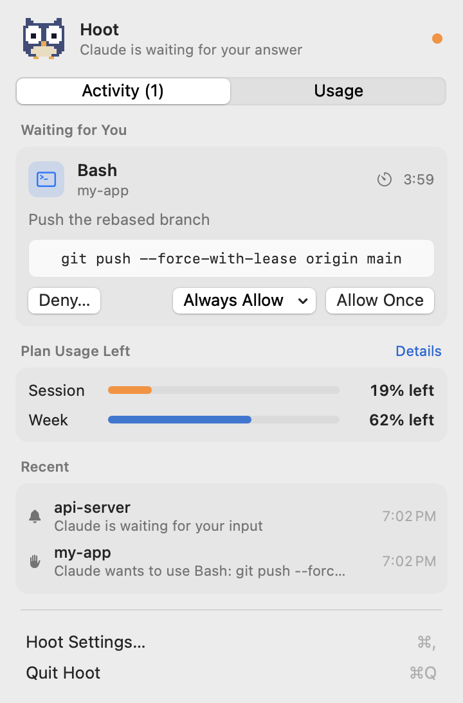
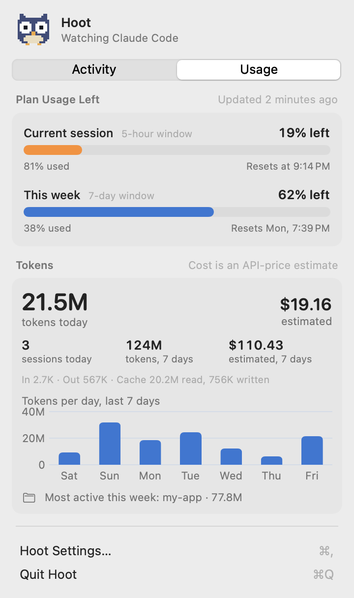

# Hoot

**A menu-bar owl for Claude Code.** Hoot tells you when Claude Code needs you *and you're not looking at the terminal*, lets you answer permission requests right from the menu bar or the notification, and shows your usage and plan limits at a glance.

> Unofficial and not affiliated with Anthropic. "Claude" and "Claude Code" are Anthropic's trademarks.

| Activity | Usage |
|---|---|
|  |  |

<sub>Screenshots use demo data.</sub>

- **Answer permission requests.** Each request appears as a card with the tool, the project and a readable preview: the full Bash command, or a diff for edits. Choose **Allow Once**, **Always Allow** (from the exact options Claude Code offered), or **Deny…** with a reason that's passed back to Claude. Notifications have Allow/Deny buttons too. The terminal dialog keeps working alongside; whichever answers first wins.
- **Questions and plans.** When Claude asks you a multiple-choice question or wants a plan approved, it shows up as a proper card: pick an answer (or type your own), approve the plan, or send it back with feedback.
- **Smart notifications.** Quiet while your terminal or editor is in front; a notification when it isn't, plus one optional reminder.
- **Usage.** Today's and the last 7 days' tokens, sessions, your most active project, a 7-day chart, and an **API-price cost estimate**.
- **Plan limits (opt-in).** Your real 5-hour session and weekly usage, from data Claude Code shares with statusline commands. The percentage used can also sit next to the owl in the menu bar.

macOS 14+, Apple Silicon.

## Works with

| Where you run Claude Code | Works? |
|---|---|
| Terminal (Terminal, iTerm2, Warp, Ghostty…) | Yes |
| IDE terminals and extensions (VS Code, Cursor…) | Yes |
| Claude desktop app, **Code** tab | Should work: it uses the same settings and hooks (add Claude under *Terminal & Editor Apps* so Hoot stays quiet while you're in it) |
| Claude desktop app, **Chat** / **Cowork** | No: those approvals don't go through hooks |

## Install

**Download** the zip from [Releases](../../releases), unzip it, and move `Hoot.app` to `/Applications`.

Hoot isn't notarized by Apple (it's a free open-source project), so the first time you open it macOS will block it. Open **System Settings › Privacy & Security**, scroll down, and click **Open Anyway** next to Hoot. Or, if you prefer the terminal:

```sh
xattr -dr com.apple.quarantine /Applications/Hoot.app
```

Or **build it yourself** (below): no warnings, and you can read every line first.

## Build and run

You only need the Xcode **Command Line Tools** (`xcode-select --install`). Full Xcode isn't required.

```sh
./scripts/build-app.sh            # builds and ad-hoc-signs build/Hoot.app
open build/Hoot.app
```

Copy it somewhere permanent if you want it to open at login:

```sh
cp -R build/Hoot.app /Applications/ && open /Applications/Hoot.app
```

Tests:

```sh
swift run HootTests
# Optional read-only checks against your real data:
HOOT_REAL_SETTINGS=~/.claude/settings.json HOOT_REAL_PROJECTS=~/.claude/projects swift run -c release HootTests
```

> **Why not XcodeGen?** XcodeGen generates Xcode projects, which need full Xcode to build. This is a Swift package plus a small script that assembles the `.app`, so it builds the same way on any Mac with the Command Line Tools. XCTest also needs Xcode, so the tests run as a plain executable (`Tests/HootTests`).

## Set up

1. **First launch:** Hoot explains what it does, then macOS asks for notification permission. For Allow/Deny buttons that stay on screen, set Hoot's style to **Persistent** in System Settings › Notifications › Hoot.
2. **Settings › Claude Code hook › Install hook…** You'll see the exact diff to `~/.claude/settings.json` before anything is written. It adds three entries and copies `~/.claude/hooks/hoot.sh`:

   | Event | What Hoot does | Blocks Claude? |
   |---|---|---|
   | `PermissionRequest` | Holds the request until you answer in the menu, answer in the terminal, or the wait runs out (5 min by default) | Only until one of those happens; the terminal dialog works the whole time |
   | `Notification` | Notifies you if you're not at the terminal | No (async) |
   | `UserPromptSubmit` | Clears alerts for that session | No (async) |

   Your file's key order and formatting are kept. A backup goes to `~/.claude/hoot-backups/` first, and Uninstall restores the file byte for byte.
3. **Optional: Settings › Plan limits › Turn on…** adds a statusline that feeds your plan limits to Hoot. If you already have a statusline, Hoot **wraps** it, so its output stays the same.
4. **Optional: Settings › General › Open Hoot at login.**

Running Claude Code sessions pick up settings changes automatically.

## How it works

```
Claude Code ──stdin JSON──▶ ~/.claude/hooks/hoot.sh ──curl──▶ Unix socket ──▶ Hoot.app
                                     ▲                                             │
                                     └──── decision JSON (or nothing) ─────────────┘
```

| Piece | File |
|---|---|
| HTTP over a Unix socket, token check, limits | `Sources/Hoot/HookServer/HookServer.swift`, `Sources/HootCore/HTTP.swift` |
| Is the terminal in front? | `Sources/Hoot/Focus/FocusMonitor.swift` |
| Queue, notifications, escalation, how a request ends | `Sources/Hoot/Inbox/AttentionCenter.swift` |
| Spot answers given in the terminal (transcript watching) | `Sources/Hoot/Inbox/TranscriptWatcher.swift`, `Sources/HootCore/TranscriptMatcher.swift` |
| Notification actions | `Sources/Hoot/Notify/NotificationManager.swift` |
| settings.json merge (order-preserving JSON) | `Sources/HootCore/HookInstaller.swift`, `OrderedJSON.swift`, `HookFiles.swift` |
| Usage parsing (incremental, FSEvents) | `Sources/HootCore/Usage*.swift`, `Sources/Hoot/Usage/` |
| Pricing table | `Sources/HootCore/Pricing.swift`; editable copy in `~/Library/Application Support/Hoot/pricing.json` |
| Statusline feed and plan limits | `Sources/HootCore/StatusLine.swift`, `Sources/Hoot/Limits/` |
| Hoot (one pixel grid → icon, menu-bar icons, SVGs, the animated mascot) | `Sources/HootCore/HootArt.swift`, `Art/` |
| Settings | `Sources/Hoot/Settings/` |

**What happens to a held permission request.** Claude Code shows its own dialog in the terminal and runs the hook at the same time. I tested this against Claude Code 2.1.301:

- **Answered in the menu bar or notification:** Claude gets the decision, and the terminal dialog closes by itself.
- **Answered in the terminal:** that answer wins, and Claude Code ignores anything the hook says later. Hoot spots the answer in the session transcript and removes its card.
- **No answer before the wait runs out, Hoot quits, or Hoot isn't running:** the hook prints nothing and the terminal dialog decides. The hook never fails and never hangs Claude Code. Claude Code's own hook timeout (wait + 15s) is a final safety net.

## Testing by hand

The hook script is the easiest way to simulate events, because it handles the token. Switch to another app first: while your terminal is in front, requests are held quietly in the menu without a notification.

```sh
# A permission request: the card appears; the command waits for your answer and prints the decision JSON.
printf '%s' '{"session_id":"t1","cwd":"/tmp/demo","hook_event_name":"PermissionRequest","tool_name":"Bash","tool_input":{"command":"rm -rf build"},"permission_suggestions":[{"type":"addRules","rules":[{"toolName":"Bash","ruleContent":"rm -rf build"}],"behavior":"allow","destination":"session"}]}' \
  | ~/.claude/hooks/hoot.sh permission

# A "Claude is waiting for input" notification.
printf '%s' '{"session_id":"t1","cwd":"/tmp/demo","hook_event_name":"Notification","notification_type":"idle_prompt","message":"Claude is waiting for your input"}' \
  | ~/.claude/hooks/hoot.sh event
```

The same thing with plain curl:

```sh
D="$HOME/Library/Application Support/Hoot"
curl --unix-socket "$D/hoot.sock" -H @"$D/auth-header" -H 'Content-Type: application/json' \
  --data-binary '{"cwd":"/tmp/demo","hook_event_name":"Notification","notification_type":"idle_prompt","message":"Claude is waiting for your input"}' \
  -i http://hoot/event        # → HTTP/1.1 204 No Content
```

For a real permission prompt, start `claude --permission-mode default` (auto mode approves most commands itself) and ask it to run something like `curl -sI https://example.com`.

## Security

- **No network exposure.** Hooks reach Hoot over a Unix socket in `~/Library/Application Support/Hoot/`. That folder is `0700`, and the socket and files inside are `0600`. Only your account can connect, and no other user can pretend to be Hoot. The hook scripts check ownership and permissions before they send anything.
- **Token.** A fresh 256-bit token is created on every launch and checked in constant time. curl reads it from a file (`-H @auth-header`), so it never shows up in `ps`. Requests that look like they come from a browser are refused.
- **Strict input handling.** Request headers are limited to 16 KB and bodies to 8 MB, there are at most 64 connections, slow clients are dropped after 10s, chunked encoding is refused, and unauthenticated requests are rejected before their body is read.
- **Previews you can trust.** Hidden and direction-changing characters (for example U+202E, zero-width characters, escape codes) are shown as `⟨U+…⟩`, with a warning. Long previews say they've been shortened.
- **No accidental approvals.** Allow has no keyboard shortcut, buttons only become active 0.8s after a card appears, and Allow from a notification requires an unlocked Mac.
- **Careful with `settings.json`.** Every change is shown as a diff first, backed up as `0600`, written atomically, and refused if the file changed after you reviewed it. Hoot never overwrites a `hoot.sh` it didn't install.
- **Statusline output is cleaned.** Text that Hoot prints into your terminal has escape codes neutralised.
- **Logs.** They record event types and outcomes only, never commands, file contents or tokens.

### Why the App Sandbox is off

Hoot has to read `~/.claude/projects` (transcripts), edit `~/.claude/settings.json`, and install scripts into `~/.claude/hooks`. A sandboxed app can only reach those through a file picker each time, or with temporary exceptions Apple's sandbox is designed to prevent. For a personal tool built from source, turning the sandbox off is the honest choice.

The tradeoff: if Hoot itself had a bug an attacker could exploit, the sandbox wouldn't limit the damage. The defences above (private socket, strict input handling, nothing listening on the network) are what keep that risk small. Hoot makes no network connections at all.

## Usage numbers

- **Source:** `~/.claude/projects/**/*.jsonl`, including subagent transcripts.
- **Counting:** one response is written across several lines that share a `message.id`, so each response is counted once, using its final numbers. Placeholder (`<synthetic>`) entries are skipped.
- **Accuracy:** the totals were cross-checked against an independent implementation on real data.
- **Cost** is an **estimate at API list prices**. It isn't what a Pro/Max plan charges. Edit `pricing.json` to change prices. Models missing from the file are listed as "unpriced" rather than counted as $0.
- **Plan limits** aren't stored anywhere locally. They only appear if you turn on the statusline feed, and they come from Claude Code's own `rate_limits` data. Hoot never estimates them.
- **Updating:** stats refresh when transcripts change (FSEvents), at midnight, and when the pricing file changes. Parsing runs in the background and only reads newly written data.

## Troubleshooting

| Problem | What to check |
|---|---|
| No notifications | System Settings › Notifications › Hoot is allowed; Focus/Do Not Disturb is off; your terminal isn't in front (requests are held quietly while it is). |
| Claude never asks | You're probably in auto or accept-edits mode. Start `claude --permission-mode default`, or press Shift+Tab until the mode badge goes away. |
| Hook not firing | Settings shows **Installed**. Check that `"disableAllHooks"` isn't `true`. Run `/hooks` in Claude Code to see the active hooks. |
| "Needs update" | You changed the wait time or updated Hoot. Click **Update hook…** |
| My editor counts as "away" | Add its bundle ID under Settings › Apps that count as looking at the terminal (the "Running apps" menu helps). |
| "Hoot is already running" | Only one copy runs at a time. Look for Hoot in the menu bar. |
| Cost shows a warning | `pricing.json` has an error. The message says where; **Reset prices…** restores the defaults. |
| Plan limits "waiting" | Limits come only from Pro/Max sessions, after Claude's first reply in that session. |
| Logs | `log stream --predicate 'subsystem == "io.github.sarthak090.hoot"' --level debug` |
| Screenshot without screen recording | `build/Hoot.app/Contents/MacOS/Hoot --render-preview /tmp/hoot.png [--with-sample | --sample-limits]` renders both tabs of the dropdown in light and dark mode (optionally with a sample request and sample plan limits), then exits. |

## Uninstall

1. Settings › Claude Code hook › **Uninstall…**, and Plan limits › **Turn off…**. Both restore `settings.json` and remove Hoot's scripts.
2. Turn off "Open Hoot at login", then quit Hoot.
3. Delete `Hoot.app`, `~/Library/Application Support/Hoot/`, and (once you no longer need the backups) `~/.claude/hoot-backups/`.

## Contributing

Issues and pull requests are welcome. Please run `swift run HootTests` before sending a change. For security problems, see [SECURITY.md](SECURITY.md) instead of opening an issue.

## License

[MIT](LICENSE)
